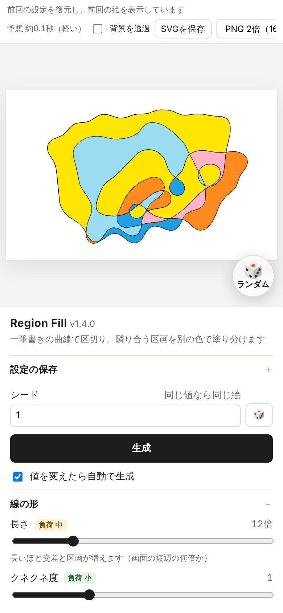
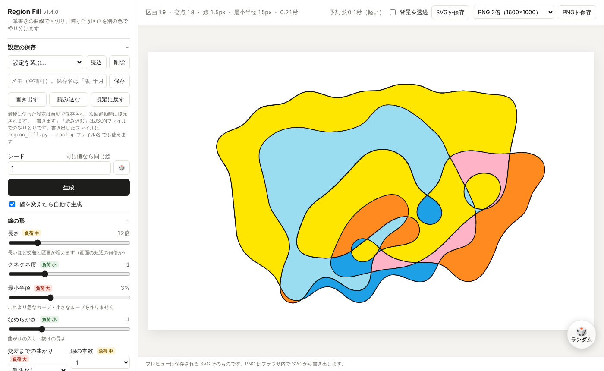
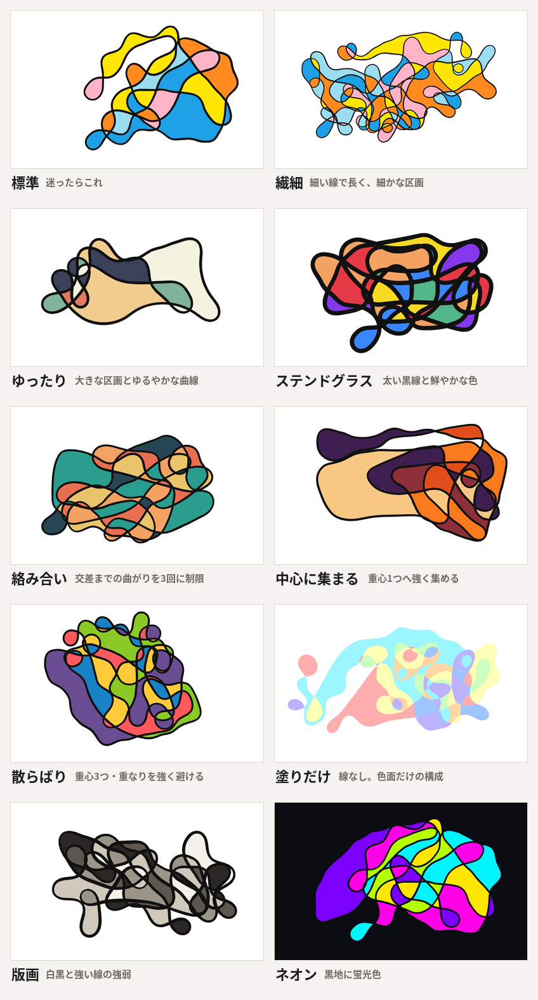

# Region Fill

一筆書きの自由曲線で画面を区切り、**辺で隣り合う区画が同じ色にならないように**自動で塗り分けて、SVG（ベクター）で出力するツールです。

## ▶ ブラウザですぐ使う（インストール不要）

**https://mulong-app.github.io/region-fill/**

上のアドレスを開くだけで使えます。Python のインストールも、ダウンロードも、GitHub のアカウントも不要です。

- 初回は準備（ブラウザの中で Python を動かすための読み込み）に **10〜20秒ほど** かかります。2回目からは速くなります
- 計算はすべてお使いのブラウザの中で行うので、読み込んだ画像や設定が外部に送られることはありません
- 設定はそのブラウザに保存されます（別のパソコンやブラウザへは、「書き出す」「読み込む」で移せます）
- パソコン版より計算に少し時間がかかります。また、「中断」したときは計算の準備をし直すため、数秒待ちます
- **スマホでも使えます**：画面の上半分に絵が常に表示され、下半分の設定だけがスクロールします





## 特徴

- **一筆書きの線**：1本の閉じた曲線が、うねりながら何度も自分と交差して区画を作ります
- **なめらかさの保証**：最小曲率半径より急なカーブや尖りを作りません。曲がりの入り・抜けもなめらかです
- **確実な塗り分け**：交点を厳密に計算して区画を求め、4色以上で塗り分けます。曲線の交点で「点」で接するだけの区画は、隣接として扱いません
- **線と塗りがぴったり一致**：塗りの輪郭は線と同じベジェ曲線なので、細い線や線なしでも隙間が出ません
- **構図の制御**：重心（1〜3個）へ緩く向かう、同じ場所を何度も並んで通らない、交差するまでに曲がってよい回数を制限する、など
- **線の強弱**：カーブで細く、ゆるやかに太さが揺らぎます
- **配色**：プリセット81種、ルールに沿った「おまかせ配色」、**画像から配色を作る**機能
- **保存**：SVG / PNG（1〜4倍）、**背景を透過して図形だけ**を保存、設定の保存・書き出し



## パソコンで使う（ダウンロード版）

ダウンロード版は、計算が少し速く、コマンドライン版も使えます。

1. このページの緑の「**Code**」ボタン →「**Download ZIP**」でダウンロードして、展開します
2. Python を入れます（https://www.python.org/downloads/ 。Windows ではインストール画面で「Add python.exe to PATH」にチェック）
3. 展開したフォルダで、次のように実行します（Windows はフォルダのアドレス欄に `cmd` と入力して Enter、Mac はターミナル）

```bash
pip install numpy            # Mac は pip3
python region_fill_gui.py    # Mac は python3
```

### 必要なもの

- Python 3.11 以上（3.13 で動作確認）
- numpy（必須）
- opencv-python（コマンドライン版で PNG を出すときだけ）
- Pillow（コマンドライン版で `--palette-from` を使うときだけ）

```bash
pip install -r requirements.txt
```

GUI は numpy だけで動きます（PNG の書き出しと画像の読み込みはブラウザ側で行います）。

## GUI の使い方

ブラウザ版も、パソコン版（`python region_fill_gui.py`）も、同じ画面です。パソコン版はブラウザが自動で開きます（開かない場合は、端末に表示されるアドレス `http://127.0.0.1:8765/` を開いてください）。終了は端末で `Ctrl+C` です。

| 操作 | 内容 |
| --- | --- |
| 生成 | 値を変えると自動で生成します（オフにもできます）。🎲 でランダムなシード |
| 中断 | 生成中に表示される「中断」ボタン、または `Esc` |
| 🎲 ランダム | 絵の右下の丸いボタン（または `R` キー）。線（太さ・強弱・色）・背景色・サイズはそのままで、形・重心・配色などをランダムにして生成します。重くなりすぎない範囲で選びます |
| 色だけ変える | 線はそのままで、塗り分けだけをやり直します |
| 配色 | カテゴリで絞り込んで選択。🎨 おまかせ配色、🖼 画像から配色（画像をドラッグしても可） |
| 設定の保存 | 保存名は自動で `v1.4.0_20261021-153045`（バージョン＋年月日-時分秒）。メモを付けると末尾に追加 |
| おすすめ設定 | 設定の一覧の「おすすめ設定」から読み込み（シードは今のまま） |
| 書き出す / 読み込む | 設定を JSON ファイルでやりとり。コマンドライン版の `--config` でも使えます |
| 背景を透過 | オンにすると、SVG・PNG とも曲線の外側を透明にして図形だけを保存 |
| サイズ | パソコンの画面（フルHD・4K など）、スマホ（iPhone・Android）、タブレット、SNS、印刷（A4・はがき）のプリセット。⇄ で縦横を入れ替え |

最後に使った設定と最後に表示した絵は自動で保存され、次回の起動時にすぐ表示されます。保存先は、ブラウザ版はそのブラウザの中、パソコン版は `region_fill_gui.py` と同じフォルダの `region_fill_settings.json` と `region_fill_settings_last.svg` です（`--settings` で変更可）。

## コマンドライン版の使い方

```bash
python region_fill.py --seed 1                       # region_v1.4.0_年月日-時分秒_s1.svg を出力
python region_fill.py --seed 1 --png                 # PNG も同じ名前で出力
python region_fill.py --style 繊細 --palette 夕焼け
python region_fill.py --palette-from photo.jpg --palette-count 6
python region_fill.py --transparent --png -o shapes.svg
python region_fill.py --config region_fill_v1.4.0_20261021-153045.json   # GUI で書き出した設定
python region_fill.py --list-styles                  # おすすめ設定の一覧
python region_fill.py --list-palettes                # 配色プリセットの一覧
python region_fill.py --help                         # すべてのオプション
```

長さの指定（`--stroke`、`--min-radius`）は、`0.3%`（画面の短辺に対する比率）でも `2` / `2px` でも書けます。線の太さの既定は `0.3%` です。比率で指定すると、画面サイズを変えても同じ見た目になります。

## 設定値と負荷（生成時間）

設定ごとに、1枚の生成にかかる時間を実測しました（パソコン版、800×500、既定の設定を基準に1項目ずつ変えた、各10枚の平均）。既定の設定では1枚 **約0.1秒** です。ブラウザ版は、これより数倍かかることがあります（倍率の傾向は同じです）。GUI では各項目の横に負荷の目安が表示され、上部に今の設定での予想時間が出ます（実際にかかった時間から、お使いのパソコンの速さに合わせて自動で補正します）。

| 設定 | 負荷 | 増え方 |
| --- | --- | --- |
| 線の長さ | 中 | 12→20 で約2倍、40 で約5倍。区画の数もほぼ比例して増える |
| 最小半径 | **大** | 3% 以下はほぼ影響なし。6% で約4倍、8% で約8倍。10% 以上はほとんど生成できない（GUI の上限は 8%） |
| 交差までの曲がり | **大** | 制限なしが最も軽い。4〜6回で約1〜2倍、3回で約2倍、2回で約12倍（ばらつきが大きく、まれに数十秒） |
| 線の本数 | 中 | 2本で約2倍、3本で約3倍 |
| なめらかさ・クネクネ度 | 小 | ほぼ影響なし |
| 重心の数・向かう強さ・重なりを避ける強さ | 小 | ほぼ影響なし |
| 線の太さ・線の強弱・色・画面サイズ | なし | 生成時間には影響しない |

GUI では1枚が30秒を超えると打ち切り、理由と対処法を表示します。

## 仕組み（概要）

1. **線を描く**：ペン先が「曲がり」（同じ向き・強さで曲がり続ける弧）をつなぎながら進みます。1歩ごとに曲がれる量に上限を設けて最小半径を守り、曲がりの強さは少しずつ変えてなめらかにします。重心へ緩く向かい、線の向き付きの密度マップを見て、同じ向きで並走する場所を避けます。最後は描き始めの区間へ、位置・向き・曲がりの強さが連続する「つなぎの曲線」を計算して合流します
2. **区画を求める**：線を細かい線分に分けて交点を求め、平面グラフ（ハーフエッジ）として面を列挙します。塗りの輪郭は、元のベジェ曲線を交点で分割したものです
3. **塗り分ける**：辺を共有する区画どうしを隣接として、DSatur（周りに使われている色が多い区画から塗る）＋バックトラックで指定色数に塗り分けます
4. **配色を画像から作る**：画像を縮小し、色の境目のにじんだ画素を除いてから、人の見た目に近い色空間（OKLab）で k-means を行い、よく使われている色・鮮やかな色・互いに離れた色を優先して選びます

## ファイル構成

| ファイル | 内容 |
| --- | --- |
| `region_fill.py` | 本体（生成・塗り分け・出力・コマンドライン版） |
| `region_fill_api.py` | GUI から呼ばれる処理（パソコン版とブラウザ版で共通） |
| `index.html` | GUI の画面（パソコン版とブラウザ版で共通。GitHub Pages ではこれがトップページ） |
| `app/worker.js` | ブラウザ版の計算担当（ブラウザの中で Python〈Pyodide〉を動かす） |
| `region_fill_gui.py` | パソコン版 GUI のローカルサーバー |
| `docs/` | README 用の画像（`palettes.png` は配色プリセット81種の一覧） |

## 更新履歴

[CHANGELOG.md](CHANGELOG.md) を参照してください。

## ライセンス

未定です。
